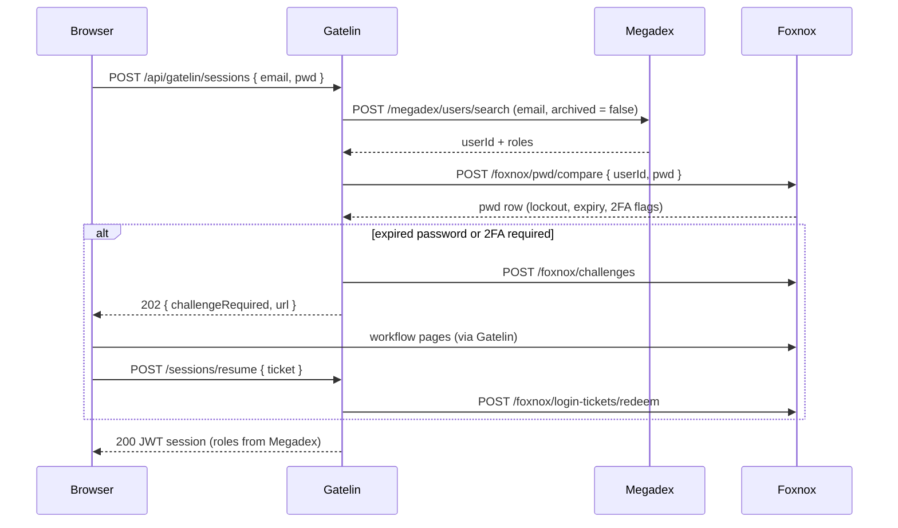
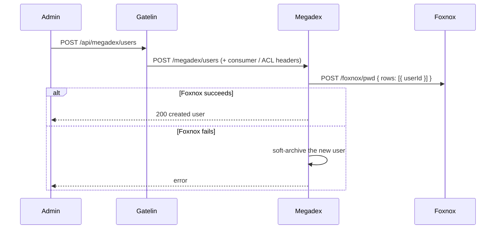
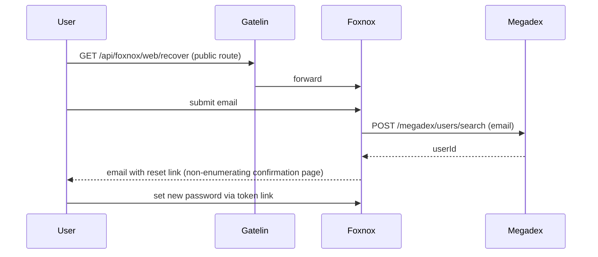

# Request Flow & Architecture

## Request Pipeline

```
Client Request
    ↓
[security] - Security headers (CSP, HSTS, X-Frame-Options, …)
    ↓
[corsMiddleware] - Origin whitelist from DB; OPTIONS → 204
    ↓
[cookieParser + /gatelin-only JSON and urlencoded parsers]
    ↓
[corsMiddleware] - Re-applied so preflight runs before route matching
    ↓
[/gatelin/health] - Liveness + DB readiness (bypasses checkRoute)
    ↓
[checkRoute] - Match request against registered DB routes
    ↓
    ├── Public login: POST /gatelin/sessions
    │     sessionLimiter (IP) → requireJson → getUserByEmail → checkPwd → challengeLogin
    │       ├── 202 { challengeRequired, kind, url }  (2FA / expired password)
    │       └── createTokens → session cache → 200
    │
    ├── Public resume: POST /gatelin/sessions/resume
    │     requireJson → redeemLoginTicket → createTokens → session cache → 200
    │
    ├── Session refresh / logout: PUT|DELETE /gatelin/sessions
    │     JWT (+ CSRF / refresh checks) → update or archive session
    │
    ├── Admin APIs: /gatelin/*
    │     checkRequest → adminLimiter (consumer, else IP) → entity handlers
    │
    └── Proxy (catch-all)
          checkRequest → proxyLimiter (consumer, else IP) → additionalHeaders → forwardToService
          (SSE: no idle timeout; GraphQL HTTP: opaque POST/GET)

WebSocket Upgrade (HTTP server, not Express)
    ↓
corsMiddleware → checkRequest → proxyLimiter → additionalHeaders → socket pipe
```

`checkRequest` expands to:

```
parseBearer → decodeAccess → checkConsumer → checkAcl → applyAclConditions
```

Login and resume (`POST /gatelin/sessions`, `POST /gatelin/sessions/resume`) skip `checkRequest` and CSRF (no session yet). Both require `Content-Type: application/json` so a cross-site HTML form cannot plant a refresh cookie. Every other matched request — including refresh — goes through JWT validation. Proxy-only steps (`additionalHeaders`, `forwardToService`) run only on the catch-all proxy router. Proxy request and response bodies remain streams; only `/gatelin/*` control-plane requests are parsed into `req.body`. WebSocket upgrades are authorized on the HTTP `upgrade` event and then piped; they never enter Express.

`challengeLogin` reads the pwd row returned by `PWD_CHECK_URL`, enforces lockout, and may mint a challenge against the password service instead of creating a session. See [Sessions](./api-sessions#login).

## Key Middlewares

| Middleware | Role |
|---|---|
| `corsMiddleware` | Enforces the DB-backed origin whitelist; allows `Authorization` and `X-CSRF-Token` |
| `checkRoute` | Validates the request matches a configured route (required for login too) |
| `checkPwd` | Calls `PWD_CHECK_URL` and stores the public pwd row on `res.locals.pwdRow` |
| `challengeLogin` | After password OK: lockout / expiry / 2FA gating; may respond `202` with a challenge URL |
| `redeemLoginTicket` | Redeems a one-shot login-resume ticket and loads the user for session creation |
| `parseBearer` / `decodeAccess` | Extract and verify the JWT access token |
| `checkConsumer` | Ensures the consumer session exists in the in-memory cache |
| `checkAcl` | Validates route/operation/scope permissions; filters writable fields only when a body was parsed (`/gatelin/*`), and resolves field/condition metadata for proxies |
| `applyAclConditions` | Injects conditions into parsed `/gatelin/*` search bodies; preserves condition metadata for proxy headers |
| `additionalHeaders` | Adds `x-consumer-user-id` / `x-consumer-name` / `x-acl-conditions` / `x-acl-fields` before forwarding |
| `checkCsrf` | Double-submit CSRF check on session refresh and logout |
| `sessionLimiter` | Caps login/refresh by IP (`SESSION_RATE_LIMIT_MAX` / 15 min) |
| `adminLimiter` / `proxyLimiter` | Caps control-plane and proxy/WS handshakes by consumer id after auth, else client IP (`X-Forwarded-For` with one trusted hop on raw upgrades) |

## Proxy ACL boundary

The data proxy is intentionally body-agnostic. Gatelin enforces route, method, scope, JWT, and permission checks before forwarding, but does not parse proxied JSON to enforce row or field rules. Protected upstream services enforce `x-acl-fields` and `x-acl-conditions`.

This split keeps HTTP forwarding transparent while retaining granular authorization:

- HTTP, GraphQL-over-HTTP, and SSE receive ACL headers on each request.
- WebSocket receives ACL headers on the upgrade handshake; frames are opaque.
- `/gatelin/*` remains fully enforced inside Gatelin because its bodies are parsed.
- Native gRPC is routed separately by Traefik/Envoy and is not handled by Gatelin.

## Production Stack

The public hostname belongs to the **edge reverse proxy**. Gatelin is the BFF behind it: `/api/*` is stripped to Gatelin’s routes (`/gatelin/*` control plane and proxied app paths). Run a **single** Gatelin process; session and ACL caches are in-memory and are not shared across replicas ([Deployment](./deployment#scaling)).

```
┌─────────────────────────────────────────────────┐
│              Edge reverse proxy                  │
│            (Traefik / nginx / Envoy)             │
│              http://your-domain.com              │
└────────────┬─────────────────────┬───────────────┘
             │                     │
   ┌─────────▼─────────┐  ┌────────▼──────────┐
   │   Admin Panel     │  │   Gatelin (BFF)   │
   │  ADMIN_BASE_PATH/*│  │   /api/*          │
   │  (default /admin) │  │   (Node.js)       │
   └─────────┬─────────┘  └────────┬──────────┘
             │                     │
             └──────────┬──────────┘
                        │
             ┌──────────▼──────────┐
             │   PostgreSQL DB     │
             │   (Gatelin data)    │
             └─────────────────────┘
             ┌─────────────────────┐
             │  Liquibase          │
             │  (DB Migrations)    │
             └─────────────────────┘
```

## Working Together: Gatelin, Foxnox and Megadex

Gatelin is the entry point of a three-service stack. It authenticates callers and proxies to [Megadex](https://megadex.fr) (users) and [Foxnox](https://foxnox.fr) (credentials), which in turn call each other directly.

```
┌─────────────────────────────────────────────────┐
│                  Reverse Proxy                   │
│                    (Traefik)                     │
│              http://your-domain.com              │
└────────────┬─────────────────────┬───────────────┘
             │                     │
   ┌─────────▼─────────┐  ┌────────▼──────────┐
   │   Admin Panels    │  │      Gatelin      │
   │     (Angular)     │  │   BFF  /api/*     │
   └───────────────────┘  └────────┬──────────┘
                                   │  internal network only
            ┌──────────────────────┼──────────────────────┐
            │                      │                      │
   ┌────────▼──────────┐           │             ┌────────▼──────────┐
   │      Megadex      │◄──────────┴─────────────┤      Foxnox       │
   │     /megadex      │     USER_SEARCH_URL     │  /foxnox  /web    │
   │     (Node.js)     ├────────────────────────►│     (Node.js)     │
   └────────┬──────────┘     PWD_CREATE_URL      └────────┬──────────┘
            │                                             │
   ┌────────▼──────────┐                         ┌────────▼──────────┐
   │    PostgreSQL     │                         │    PostgreSQL     │
   │   (megadex DB)    │                         │   (foxnox DB)     │
   └───────────────────┘                         └───────────────────┘
```

Each service owns its own database and knows the others only by HTTP contract.

| Service | Owns | Never does |
|---|---|---|
| **Gatelin** | Sessions, JWTs, routes, roles, permissions, CORS | Store password hashes or user profiles |
| **Megadex** | Users, roles assignment, social links, preferences, lookups | Store credentials or issue sessions |
| **Foxnox** | Password hashes, 2FA, tokens, trusted devices, workflow pages | Mint JWTs or store user profiles |

Users are identified by email at the edge and by numeric `userId` everywhere else. Megadex is the only place that translates one into the other.

### Sign-in



### Account creation



### Password recovery



### Who calls whom

| Caller | Callee | Variable | Purpose |
|---|---|---|---|
| Gatelin | Megadex | `USER_SEARCH_URL` | Resolve email to `userId` at login |
| Gatelin | Foxnox | `PWD_CHECK_URL` | Verify the password |
| Gatelin | Foxnox | `PWD_CHALLENGES_URL`, `PWD_TRUSTED_DEVICES_URL`, `PWD_LOGIN_TICKET_URL` | Mid-login 2FA / expired-password steps |
| Foxnox | Megadex | `USER_SEARCH_URL` | Resolve email in recovery, unlock, and 2FA recovery |
| Megadex | Foxnox | `PWD_CREATE_URL` | Create a password on user creation; archive it on user archival |
| Gatelin | Megadex, Foxnox | Route and permission seeds | Proxy admin and self-service traffic with consumer and ACL headers |

### Boundaries to keep in mind

- **Trust**: Megadex and Foxnox trust Gatelin's `x-consumer-*` and `x-acl-*` headers, so only Gatelin (and each other) may reach their ports. Neither should have a public router.
- **Sessions**: Gatelin owns session state. Role changes or archival in Megadex take effect only when the access token expires or refresh fails; nothing pushes a revocation.
- **Coupling**: Megadex creating a user fails (and rolls back by archiving) if Foxnox is down. Gatelin login fails if Megadex or Foxnox is unreachable.
- **Optional**: Each service works with other implementations of the same HTTP contract. A custom BFF, user service, or credential store can replace any one of the three.

### Reference values

The other pages use generic placeholders. For the three services shipped together, the concrete values are:

| Placeholder | Concrete value |
|---|---|
| `<bff-image>` / `<bff-migration-image>` | `ghcr.io/alten-group/gatelin` / `ghcr.io/alten-group/gatelin-migration` |
| `<bff-seed-folder>` | `gatelin-data` (`db/liquibase/gatelin-data/` in the Foxnox and Megadex checkouts) |
| `/api/<bff>/roles/search` (`ADMIN_ROLES_SEARCH_URL`) | `/api/gatelin/roles/search` |
| Password service URLs (`/pwd`, `/pwd/compare`, `/challenges`, `/devices/verify`, `/login-tickets/redeem`) | the same paths under `/foxnox`, on `ghcr.io/alten-group/foxnox` |
| `ADMIN_PASSWORD_RECOVERY_URL` example (`/api/password-service/web/recover`) | `/api/foxnox/web/recover` |
| User service URL (`/users/search`) | `/megadex/users/search`, on `ghcr.io/alten-group/megadex` |

## Background Jobs

Started with the API process:

- **Delete archived entities** — daily 02:00 UTC; removes rows archived for more than 2 months
- **Delete old history** — daily 03:00 UTC; removes `log.history` rows older than 6 months
